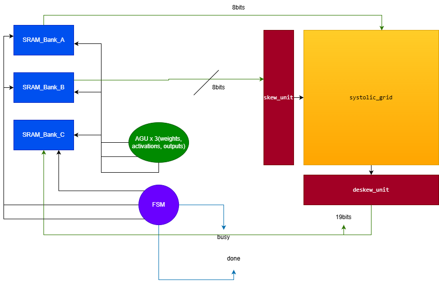

# Systolic_array
This is a personal project of mine in an attempt to better understand custom datapaths and power consumption. It is written in SystemVerilog and is highly parameterized
## 1. Architecture Overview

This design follows the Weight Stationary architecture and contains:
* **Systolic Grid**: A parameterized mesh of Processing Elements performing Multiply-Accumulate (MAC) operations. The weights are pre-loaded vertically using a countdown Address Generation Unit, while activation streams march horizontally.
* **Skew & Deskew Units:** Register structures that offset the input and the corresponding output , so that the resulting matrix is the correct one.
* **Memory Subsystem:** Three independent synchronous SRAM banks (`bank_a` for weights, `bank_b` for activations, `bank_c` for outputs) managed via dedicated AGUs and controlled by a FSM.
## 2. Key Features
* **Parameterizable Precision:** Configurable `DATA_WIDTH` (default 8-bit signed) and `ACC_WIDTH` (19-bit accumulator with 3 guard bits to prevent arithmetic overflow.
* **Deterministic Pipeline Latency:** Cycle-accurate valid generation (`PIPELINE_DEPTH = 31` cycles) coordinating SRAM read latency, input skewing, and array traversal.

## 3. Verification

`tb_tpu_wrapper.sv` is a self-checking testbench. It preloads signed 8×8 matrices (including negative values and zeros) into the SRAM banks, runs the array, reads bank C and compares every output to a golden matrix multiply. It prints `[PASS]` when all 64 outputs match. It writes the memories by hierarchical path, so it runs in RTL simulation only.

## 4. Synthesis results

Simulation and Synthesis were done in Vivado, for an AMD Zynq-7000 XC7Z010 (`xc7z010iclg225-1L`). I had 10 ns clock constraint and post-synthesis timing does not include routing delay.

**Default build (LUT multipliers):**

| Resource | Used | % of device |
|---|---|---|
| Slice LUTs | 6,866 | 39.0% |
| Slice registers | 5,267 | 15.0% |
| Block RAM tiles | 8.5 | 14.2% |
| DSP48E1 | 0 | 0% |

Setup timing met at 10 ns, WNS +1.84 ns.

### Multiplier mapping: LUT vs DSP48E1

The PE multiply (`gated_act * gated_wt`, 8×8 signed) can be built from LUTs or DSP48E1 slices. I synthesised both variants of the same array. The only difference is the `MULT_DSP` define, which adds `(* use_dsp = "yes" *)` to the product register in `PE`. Operand isolation is enabled in both builds.

| | LUT multipliers | DSP multipliers |
|---|---|---|
| Slice LUTs | 6,866 (39.0%) | 3,226 (18.3%) |
| Slice registers | 5,267 (15.0%) | 5,267 (15.0%) |
| DSP48E1 | 0 / 80 | 64 / 80 |
| Block RAM tiles | 8.5 / 60 | 8.5 / 60 |
| LUTs in `u_grid` | 6,464 | 2,824 |
| WNS at 10 ns | +1.84 ns | |

- DSP mapping removes 3,640 LUTs (53% of the design), all from the PE grid: about 101 LUTs per PE before, about 44 after. One DSP per PE uses 64 of 80 slices.
- The register count is identical (5,267). The product register stayed in fabric flip-flops, so the DSP's internal registers are not used. A likely cause is the asynchronous reset on every PE register, since the DSP48E1 supports only synchronous resets. It should be noted that this has not been tested.
- The isolation logic stays in LUTs in front of the DSP inputs.

## 5. Limitations and future work

- **Power is not yet characterised.** Vivado's estimate uses default switching activity and cannot show the effect of sparsity. The next step is SAIF-based power analysis from a post-synthesis simulation, comparing the isolated and baseline PE across sparsity levels.
- **Asynchronous reset likely blocks DSP register absorption.** Moving the PE to synchronous reset is the next experiment for the DSP variant.
- **Verification includes only 8x8** . Random and sparse stimulus, and other grid sizes, are not yet covered.
- **Post-synthesis results only.** Post-route area and timing may differ.
- **Not integrated with a bus.** The host port is a simple memory interface. Connecting it to a processor (for example through AXI4-Lite) is not done.
 
