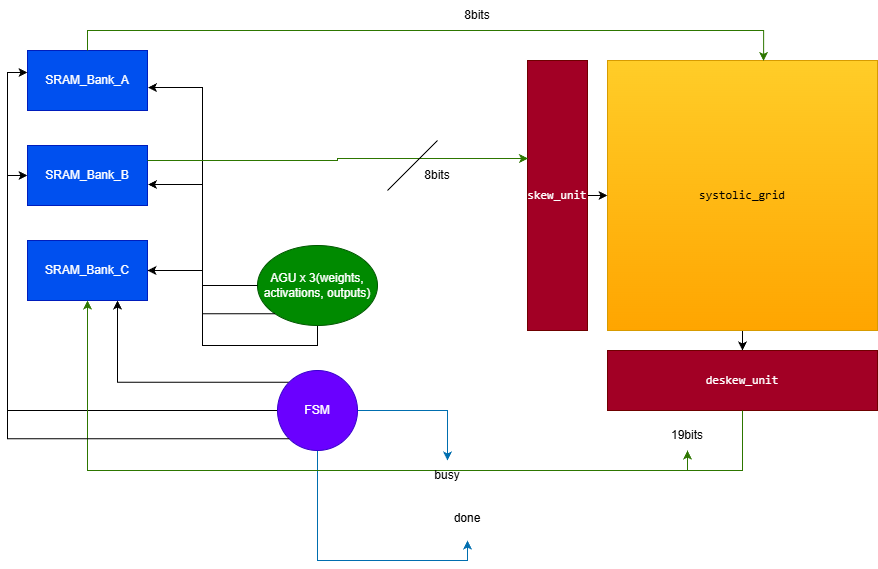

# Systolic_array
This is a personal project of mine in an attempt to better understand custom datapaths and power consumption. It is written in SystemVerilog and is highly parameterized
## 1. Architecture Overview

This design follows the Weight Stationary architecture 
